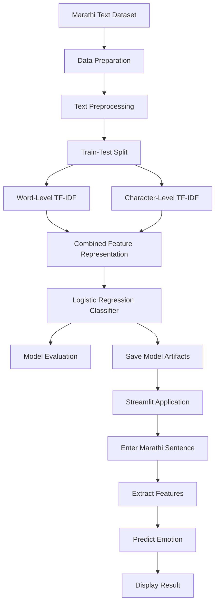

# EmotionSense Marathi NLP

### Marathi Emotion Detection Using Natural Language Processing and Machine Learning

**Understand emotions in Marathi text. Explore language patterns. Make text more meaningful.**

<p align="center">
  <a href="https://emotionsense1.streamlit.app/">
    
  </a>
  <a href="https://github.com/seanandrades1701/Emotion-Sense">
    
  </a>
</p>

EmotionSense is a Marathi Natural Language Processing (NLP) project that classifies Marathi sentences into six emotion categories using machine learning and TF-IDF-based feature extraction. The system combines text preprocessing, word-level and character-level features, Logistic Regression, and an interactive Streamlit web application to predict emotions from Marathi text.

---

## Table of Contents

- [Overview](#overview)
- [Key Features](#key-features)
- [Supported Emotions](#supported-emotions)
- [System Workflow](#system-workflow)
- [Dataset](#dataset)
- [Text Preprocessing](#text-preprocessing)
- [Feature Extraction](#feature-extraction)
- [Model Training and Evaluation](#model-training-and-evaluation)
- [Technology Stack](#technology-stack)
- [Project Structure](#project-structure)
- [Getting Started](#getting-started)
- [Running the Application](#running-the-application)
- [Training and Evaluation](#training-and-evaluation)
- [Deployment](#deployment)
- [Limitations](#limitations)
- [Future Improvements](#future-improvements)
- [Author](#author)

---

## Overview

EmotionSense aims to identify emotional expressions in Marathi sentences using Natural Language Processing and supervised machine learning.

Marathi text presents challenges related to vocabulary, grammatical structures, spelling variations, and informal writing. This project explores how text preprocessing and combined word-level and character-level TF-IDF features can help classify Marathi sentences into predefined emotion categories.

Users can enter Marathi text through the web application and receive a predicted emotion category.

### Key Features

- **Marathi Emotion Detection:** Classifies Marathi sentences into six predefined emotion categories.
- **Six Emotion Categories:** Supports happiness, surprise, sadness, fear, anger, and neutral expression.
- **Text Preprocessing:** Cleans and prepares sentences for feature extraction.
- **Word-Level TF-IDF:** Extracts informative word-based features.
- **Character-Level TF-IDF:** Captures character sequences and word-form patterns.
- **Combined Feature Extraction:** Integrates word-level and character-level representations.
- **Machine Learning Classification:** Uses a trained Logistic Regression classifier.
- **Interactive Web Application:** Provides a user-friendly Streamlit interface.
- **Model Persistence:** Reuses saved vectorizers and classifier artifacts for predictions.
- **Model Evaluation:** Evaluates performance on held-out and separate unseen datasets.
- **Live Deployment:** Makes the application accessible through Streamlit Community Cloud.

---

## Supported Emotions

EmotionSense recognizes six emotion categories.

| Marathi Label | English Label | Description |
|---|---|---|
| आनंदी | Happy | Happiness, joy, or pleasure |
| आश्चर्य | Surprise | Surprise, amazement, or unexpected reactions |
| दुःखी | Sad | Sadness, disappointment, or sorrow |
| भीती | Fear | Fear, worry, or apprehension |
| राग | Anger | Anger, irritation, or frustration |
| सामान्य | Neutral | Relatively neutral or ordinary expression |

The model predicts the category that best matches the learned patterns in the input sentence. This prediction does not necessarily represent the writer's actual emotional state.

---

## System Workflow

The project follows a structured workflow from Marathi text input to emotion prediction.



### Workflow Stages

1. **Data preparation:** Load and inspect labeled Marathi sentences.
2. **Text preprocessing:** Clean the text using the project's preprocessing pipeline.
3. **Feature extraction:** Transform sentences into word-level and character-level TF-IDF features.
4. **Model training:** Train the Logistic Regression classifier.
5. **Model evaluation:** Evaluate the model on held-out and unseen examples.
6. **Model persistence:** Save the trained classifier and its corresponding vectorizers.
7. **Prediction:** Transform new text using the saved feature extractors and predict its emotion.
8. **Application interface:** Display the prediction through the Streamlit web application.

---

## Dataset

The project uses a labeled Marathi text dataset containing sentences associated with six emotion categories.

The expanded dataset used during development contains **1,200 sentences**, with 200 sentences per emotion category.

| Dataset Property | Description |
|---|---|
| Language | Marathi |
| Data type | Text sentences |
| Target variable | Emotion |
| Number of categories | 6 |
| Expanded dataset size | 1,200 sentences |
| Samples per category | 200 |
| Feature representation | Word-level and character-level TF-IDF |

### Dataset Preparation

The preparation process includes:

- Inspecting sentence and emotion-label columns.
- Checking the distribution of emotion categories.
- Cleaning text before feature extraction.
- Preparing data for model training and evaluation.
- Evaluating the model on a separate unseen dataset.

A separate evaluation dataset, `unseen_test_300.csv`, contains **300 sentences**, with 50 sentences per emotion category.

Using a separate dataset helps assess how well the model performs on additional examples. The strength of this evaluation depends on whether those examples remained independent during model development and tuning.

---

## Text Preprocessing

Text preprocessing prepares Marathi sentences for feature extraction and classification.

The preprocessing pipeline includes the following operations, where applicable to the implementation:

| Step | Purpose |
|---|---|
| Text cleaning | Removes unwanted punctuation and characters |
| Number removal | Removes English and Marathi digits where configured |
| Stopword removal | Removes selected common words |
| Tokenization | Divides text into tokens for processing |
| Consistent transformation | Applies compatible preprocessing during training and prediction |

Preprocessing must remain consistent between model training and prediction. Changes to the preprocessing pipeline may affect the model's output.

---

## Feature Extraction

Machine learning algorithms require numerical input. EmotionSense uses **Term Frequency–Inverse Document Frequency (TF-IDF)** to transform text into numerical feature vectors.

### Word-Level TF-IDF

Word-level TF-IDF represents sentences using word-based features. It assigns importance to words according to their frequency in a sentence and their distribution across the dataset.

### Character-Level TF-IDF

Character-level TF-IDF represents sentences through character sequences. These features can capture partial word patterns, spelling differences, and variations in word forms.

### Combined Feature Representation

EmotionSense combines word-level and character-level features to provide complementary information to the classifier.

The trained model expects features generated by the corresponding saved vectorizers. Therefore, the same vectorizers must be loaded during prediction rather than fitted again on individual input sentences.

---

## Model Training and Evaluation

EmotionSense uses **Logistic Regression** for multiclass emotion classification.

The project evaluates model performance using a held-out test set, cross-validation, and a separate unseen dataset.

### Reported Results

| Evaluation Metric | Result |
|---|---:|
| Held-out test accuracy | 99.17% |
| Five-fold cross-validation accuracy | 98.75% ± 1.34% |
| Separate unseen dataset accuracy | 93.00% |
| Unseen evaluation samples | 300 |
| Correct predictions on unseen data | 279 out of 300 |

### Understanding the Results

- **Held-out test accuracy:** The proportion of correct predictions on the test split used during model development.
- **Cross-validation accuracy:** The mean accuracy across five validation folds, with a reported variation of 1.34 percentage points.
- **Unseen dataset accuracy:** The proportion of correct predictions on the separate dataset of 300 sentences.

The unseen evaluation produced 279 correct predictions out of 300, corresponding to 93% accuracy.

The difference between held-out and unseen accuracy demonstrates why testing on additional data is important. Performance can vary with sentence diversity, vocabulary, writing style, and the similarity between evaluation examples and training data.

These figures reflect the reported experiments and do not guarantee equivalent accuracy on every Marathi sentence or real-world dataset.

---

## Technology Stack

| Technology | Purpose |
|---|---|
| Python | Core programming language |
| Pandas | Dataset loading and manipulation |
| NumPy | Numerical operations |
| Scikit-learn | TF-IDF, Logistic Regression, and evaluation metrics |
| SciPy | Supporting numerical and sparse-matrix operations |
| Joblib | Saving and loading trained artifacts |
| Streamlit | Interactive web application |
| Git | Version control |
| GitHub | Source-code hosting |

---

## Project Structure

The following structure represents the main project components. Confirm the actual filenames and paths in your repository before treating this as an exact directory listing.

```text
Emotion-Sense/
│
├── app.py
├── preprocessing.py
├── train_model.py
├── predict.py
├── evaluate_unseen.py
├── requirements.txt
├── README.md
├── stopwords.txt
│
├── dataset/
│   ├── original_dataset.csv
│   ├── cleaned_dataset.csv
│   └── unseen_test_300.csv
│
└── models/
    ├── word_tfidf.pkl
    ├── char_tfidf.pkl
    └── emotion_model_word_char.pkl
```

### Main Components

| File or Folder | Responsibility |
|---|---|
| `app.py` | Runs the Streamlit application |
| `preprocessing.py` | Contains text preprocessing functions |
| `train_model.py` | Trains the model and saves model artifacts |
| `predict.py` | Supports emotion prediction using saved artifacts |
| `evaluate_unseen.py` | Evaluates the model on unseen test data |
| `requirements.txt` | Lists the required Python packages |
| `stopwords.txt` | Contains stopwords used during preprocessing |
| `dataset/` | Stores training and evaluation datasets |
| `models/` | Stores the trained classifier and vectorizers |

Keep model filenames consistent with the paths referenced by your Python scripts. Only include files that exist in your final repository.

---

## Getting Started

### Prerequisites

- Python installed on your computer.
- Git, if cloning the repository.
- Visual Studio Code or another code editor.
- Required datasets and model artifacts.

### 1. Clone the Repository

```bash
git clone https://github.com/seanandrades1701/Emotion-Sense.git
cd Emotion-Sense
```

Alternatively, download the repository as a ZIP file and open the extracted folder in Visual Studio Code.

### 2. Create a Virtual Environment

**Windows PowerShell**

```powershell
python -m venv venv
.\venv\Scripts\Activate.ps1
```

If PowerShell blocks activation, use Command Prompt:

```bat
venv\Scripts\activate.bat
```

### 3. Install Dependencies

```bash
python -m pip install --upgrade pip
pip install -r requirements.txt
```

Ensure that `requirements.txt` contains every package imported by the application and supporting scripts.

### 4. Verify Model Files

Before launching the application, confirm that:

- The required `.pkl` files exist.
- The classifier and vectorizers belong to the same trained model version.
- Dataset paths are correct.
- All dependencies are installed.

---

## Running the Application

From the project root, activate the virtual environment and run:

```bash
streamlit run app.py
```

Streamlit will display a local URL, usually:

```text
http://localhost:8501
```

Open this address in your browser to access the application locally.

### Making a Prediction

1. Open EmotionSense.
2. Enter a Marathi sentence in the input area.
3. Submit the sentence for analysis.
4. The application processes the text and extracts its features.
5. View the predicted emotion category.

You can also use the live application without installing anything:

**[Launch EmotionSense](https://emotionsense1.streamlit.app/)**

---

## Training and Evaluation

### Train the Model

To retrain the classifier, run:

```bash
python train_model.py
```

This command assumes the training script is configured to load the dataset from the expected location and save the model artifacts.

### Evaluate on Unseen Data

Run:

```bash
python evaluate_unseen.py
```

This script evaluates the saved model on the configured unseen dataset. Verify that it uses the intended dataset and the latest model artifacts before interpreting the results.

### Run the Prediction Script

If `predict.py` supports standalone execution, run:

```bash
python predict.py
```

Otherwise, use the prediction functionality through the Streamlit application.

---

## Deployment

EmotionSense is deployed using **Streamlit Community Cloud**.

**Live Application:** [https://emotionsense1.streamlit.app/](https://emotionsense1.streamlit.app/)

| Property | Value |
|---|---|
| Application | EmotionSense Marathi NLP |
| Source code | [GitHub Repository](https://github.com/seanandrades1701/Emotion-Sense) |
| Hosting platform | Streamlit Community Cloud |
| Main application file | `app.py` |
| Dependencies | `requirements.txt` |
| Live URL | [emotionsense1.streamlit.app](https://emotionsense1.streamlit.app/) |

For future deployments, ensure that the required model files are available, dependencies are correctly declared, and file paths work in the cloud environment.

A custom domain is not required for a standard Streamlit Community Cloud deployment.

---

## Limitations

- The dataset may not cover every Marathi dialect or regional writing variation.
- The model is restricted to the six emotion categories used during training.
- Sarcasm, ambiguous expressions, mixed emotions, and informal text can be difficult to classify.
- Model performance depends on the diversity and quality of the dataset and its labels.
- High held-out accuracy does not guarantee equivalent performance on new datasets.
- The classifier identifies patterns in text; it does not establish a person's actual emotional or psychological state.

---

## Future Improvements

- Expand the dataset with more diverse and naturally written Marathi sentences.
- Add support for dialects, informal expressions, and Marathi-English code-mixed text.
- Include confusion matrices and per-class precision, recall, and F1-score.
- Compare Logistic Regression with other suitable machine learning algorithms.
- Explore transformer-based Marathi language models.
- Improve handling of sarcasm and sentences expressing multiple emotions.
- Add prediction confidence displays with suitable explanations.
- Improve the dashboard with prediction history and additional evaluation visualizations.
- Evaluate the model on more independently collected datasets.

---

## Author

**Sean Andrades**

Developed as a Marathi Natural Language Processing and machine learning project.

---

## Acknowledgements

This project applies text preprocessing, TF-IDF feature extraction, and supervised machine learning to Marathi emotion classification.

Dataset sources and attribution should be documented according to the actual origin and usage conditions of the data.

---

<p align="center">
  <strong>EmotionSense — Bringing emotion classification to Marathi text through NLP and machine learning.</strong>
  <br/><br/>
  <a href="https://emotionsense1.streamlit.app/">Try the Live Application</a>
  &nbsp; | &nbsp;
  <a href="https://github.com/seanandrades1701/Emotion-Sense">Explore the Source Code</a>
</p>
