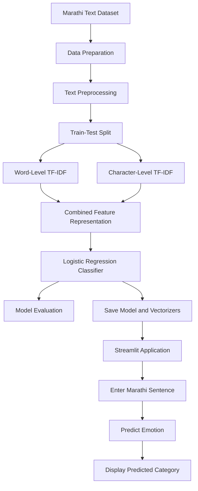

EmotionSense Marathi NLP

Marathi Emotion Detection Using Natural Language Processing and Machine Learning

Understand emotions in Marathi text. Explore language patterns. Make text more meaningful.

🌐 Live Demo: EmotionSense — Try the Application

EmotionSense is a Marathi Natural Language Processing (NLP) project that classifies Marathi sentences into six emotion categories using machine learning and TF-IDF-based text feature extraction. It provides an interactive interface for entering Marathi text and identifying its predicted emotional category.

The project combines text preprocessing, word-level and character-level TF-IDF features, machine learning, model evaluation, and an interactive Streamlit application.

---

## Table of Contents

- [Overview](#overview)
- [Key Features](#key-features)
- [Supported Emotions](#supported-emotions)
- [System Workflow](#system-workflow)
- [Dataset](#dataset)
- [Text Preprocessing](#text-preprocessing)
- [Feature Extraction](#feature-extraction)
- [Model Training and Evaluation](#model-training-and-evaluation)
- [Technology Stack](#technology-stack)
- [Project Structure](#project-structure)
- [Getting Started](#getting-started)
- [Running the Application](#running-the-application)
- [Evaluating the Model](#evaluating-the-model)
- [Deployment](#deployment)
- [Limitations](#limitations)
- [Future Improvements](#future-improvements)
- [Author](#author)

---

## Overview

EmotionSense aims to identify the emotional meaning expressed in Marathi sentences. Since Marathi is a regional language with its own vocabulary, grammatical structures, and variations in written expression, emotion classification requires suitable text preprocessing and feature representation.

The system processes an input sentence, converts its text into numerical features, and uses a trained machine learning model to predict one of six emotion categories.

The project explores how word-level and character-level TF-IDF features can be combined to represent Marathi text and support emotion classification.

### Key Features

- **Marathi Emotion Detection** — Predict the emotional category of a Marathi sentence.
- **Six Emotion Categories** — Identify happiness, surprise, sadness, fear, anger, and neutral expression.
- **Text Preprocessing** — Prepare input text for consistent feature extraction.
- **Word-Level TF-IDF** — Capture informative word patterns in Marathi sentences.
- **Character-Level TF-IDF** — Capture character sequences that can help represent spelling and word-form variations.
- **Combined Feature Representation** — Use word and character features together for classification.
- **Machine Learning Classification** — Predict emotion using a trained Logistic Regression model.
- **Interactive Dashboard** — Enter Marathi text through a Streamlit interface.
- **Model Evaluation** — Evaluate performance on held-out and separate unseen datasets.
- **Reusable Model Artifacts** — Load saved vectorizers and the trained classifier instead of retraining for every prediction.

---

## Supported Emotions

The classifier supports six emotion labels.

| Marathi Label | English Meaning | Description |
|---|---|---|
| आनंदी | Happy | Expresses happiness, joy, or pleasure |
| आश्चर्य | Surprise | Expresses surprise, amazement, or unexpected reactions |
| दुःखी | Sad | Expresses sadness, disappointment, or sorrow |
| भीती | Fear | Expresses fear, worry, or apprehension |
| राग | Anger | Expresses anger, irritation, or frustration |
| सामान्य | Neutral | Expresses a relatively neutral or ordinary statement |

The predicted category represents the model's classification of the sentence, not a definitive measurement of the writer's emotional state.

---

## System Workflow

The project follows a structured workflow from raw Marathi text to emotion prediction.



### Workflow Stages

1. **Dataset preparation:** Load and inspect the labeled Marathi sentence dataset.
2. **Text preprocessing:** Clean the text and prepare it for feature extraction.
3. **Feature extraction:** Convert sentences into word-level and character-level TF-IDF representations.
4. **Model training:** Train a classifier using the extracted features and emotion labels.
5. **Model evaluation:** Measure performance on held-out and unseen data.
6. **Model persistence:** Save the trained classifier and corresponding vectorizers.
7. **Prediction:** Process new Marathi input using the same feature extraction pipeline.
8. **Visualization and interaction:** Display the predicted emotion through the application interface.

---

## Dataset

EmotionSense uses a labeled Marathi text dataset containing sentences associated with six emotion categories.

The project was developed with an expanded dataset containing **1,200 sentences**, distributed across the six emotion labels.

| Dataset Property | Description |
|---|---|
| Language | Marathi |
| Data type | Text sentences |
| Target variable | Emotion |
| Number of emotion categories | 6 |
| Reported expanded dataset size | 1,200 sentences |
| Feature representation | Word-level and character-level TF-IDF |

### Dataset Preparation

The dataset preparation process includes:

- Inspecting sentence and emotion-label columns.
- Checking class distribution.
- Cleaning text before feature extraction.
- Preparing the data for model training and evaluation.
- Maintaining a separate unseen test dataset to evaluate generalization.

A separate unseen evaluation dataset of **300 sentences**, containing 50 sentences per emotion category, was used to assess the model on additional examples.

The quality and diversity of the examples are important because repeated or highly similar sentences can make evaluation results appear better than real-world performance.

---

## Text Preprocessing

Text preprocessing prepares Marathi sentences for numerical representation and classification.

The preprocessing workflow includes the following operations where applicable:

| Step | Purpose |
|---|---|
| Text cleaning | Remove unwanted punctuation and irrelevant characters |
| Number removal | Remove English and Marathi digits where required by the pipeline |
| Stopword removal | Remove selected common words that contribute limited information |
| Tokenization | Divide sentences into tokens for text processing |
| Consistent transformation | Apply compatible preprocessing during training and prediction |

Preprocessing should be applied consistently to training examples and incoming text. The exact preprocessing steps depend on the implementation in `preprocessing.py`.

---

## Feature Extraction

Machine learning models cannot directly learn from raw text in its original form. EmotionSense uses **Term Frequency–Inverse Document Frequency (TF-IDF)** to convert text into numerical features.

### Word-Level TF-IDF

Word-level TF-IDF represents sentences through word-based features. It gives greater importance to terms that are informative within the dataset.

### Character-Level TF-IDF

Character-level TF-IDF represents text through character sequences. These features can capture useful patterns in words, including partial word forms and spelling variations.

### Combined Feature Representation

The project combines word-level and character-level features to provide the classifier with complementary information.

The saved vectorizers transform new input into the same feature representation expected by the trained classifier.

---

## Model Training and Evaluation

EmotionSense uses Logistic Regression for multiclass emotion classification.

The project evaluates model performance using a held-out test set, cross-validation, and a separate unseen dataset.

### Reported Results

| Evaluation Metric | Reported Result |
|---|---:|
| Held-out test accuracy | 99.17% |
| Five-fold cross-validation accuracy | 98.75% ± 1.34% |
| Separate unseen dataset accuracy | 93.00% |
| Unseen evaluation samples | 300 |
| Correct predictions on unseen dataset | 279 out of 300 |

### Understanding the Results

- **Held-out test accuracy:** Measures the percentage of correct predictions on the test split used during model development.
- **Cross-validation accuracy:** Estimates performance across multiple training and validation splits.
- **Unseen dataset accuracy:** Measures performance on the separate 300-sentence evaluation dataset.

The difference between the held-out and unseen results indicates that performance can vary with the examples being evaluated. The unseen evaluation is particularly useful for examining how well the model handles additional sentences.

These results are specific to the datasets and evaluation procedures used in the project. They should not be interpreted as a guarantee of the same accuracy for every Marathi sentence or real-world text source.

---

## Technology Stack

| Technology | Purpose |
|---|---|
| Python | Core programming language |
| Pandas | Dataset loading and manipulation |
| NumPy | Numerical operations |
| Scikit-learn | TF-IDF feature extraction, Logistic Regression, and evaluation |
| SciPy | Supporting numerical and sparse-matrix operations |
| Joblib | Saving and loading model artifacts |
| Streamlit | Interactive web application |
| Git | Version control |
| GitHub | Source-code hosting |

---

## Project Structure

The following structure represents the main components of EmotionSense. File names may vary depending on the current repository version.

```text
EmotionSense/
│
├── app.py
├── preprocessing.py
├── train_model.py
├── predict.py
├── evaluate_unseen.py
├── requirements.txt
├── README.md
├── stopwords.txt
│
├── dataset/
│   ├── original_dataset.csv
│   ├── cleaned_dataset.csv
│   └── unseen_test_300.csv
│
└── models/
    ├── word_tfidf.pkl
    ├── char_tfidf.pkl
    └── emotion_model_word_char.pkl
```

### Main Components

| File | Responsibility |
|---|---|
| `app.py` | Runs the Streamlit application |
| `preprocessing.py` | Contains text preprocessing functions |
| `train_model.py` | Trains and saves the classification model and vectorizers |
| `predict.py` | Supports emotion prediction using saved artifacts |
| `evaluate_unseen.py` | Evaluates performance on the separate unseen dataset |
| `requirements.txt` | Lists Python dependencies |
| `stopwords.txt` | Contains stopwords used by the preprocessing pipeline |
| `dataset/` | Stores training and evaluation datasets |
| `models/` | Stores trained model and vectorizer artifacts |

Keep the model filenames and directory paths consistent with the loading paths used in the Python scripts.

---

## Getting Started

### Prerequisites

- Python installed on your system.
- Git, if cloning the repository.
- A terminal or code editor such as Visual Studio Code.
- The required dataset and saved model artifacts.

### 1. Clone the Repository

Replace the placeholder below with your actual GitHub repository URL.

```bash
git clone <YOUR_EMOTIONSENSE_REPOSITORY_URL>
cd EmotionSense
```

Alternatively, download the repository and open its folder in Visual Studio Code.

### 2. Create a Virtual Environment

**Windows PowerShell**

```powershell
python -m venv venv
.\venv\Scripts\Activate.ps1
```

If PowerShell blocks virtual environment activation, use Command Prompt:

```bat
venv\Scripts\activate.bat
```

### 3. Install Dependencies

```bash
python -m pip install --upgrade pip
pip install -r requirements.txt
```

Ensure that `requirements.txt` contains all libraries imported by the application and its supporting scripts.

### 4. Verify the Project Files

Before running the application, check that:

- The required model files exist.
- The word and character vectorizers match the trained classifier.
- Dataset paths are correct.
- All required dependencies are installed.

---

## Running the Application

From the project root, activate the virtual environment and execute:

```bash
streamlit run app.py
```

Streamlit will display a local URL, usually:

```text
http://localhost:8501
```

Open the URL in a browser to access the application.

### Making a Prediction

1. Open the EmotionSense application.
2. Enter a Marathi sentence in the text input area.
3. Submit the text for analysis.
4. Allow the application to preprocess the input and generate TF-IDF features.
5. View the predicted emotion category.

The application must use the same preprocessing and feature extraction approach that was used when training the model.

---

## Training and Evaluating the Model

### Train the Model

To retrain the classifier using the available dataset, run:

```bash
python train_model.py
```

This command assumes that the training script is configured to read the dataset from its expected location and save the required model artifacts.

### Evaluate on Unseen Data

Run:

```bash
python evaluate_unseen.py
```

This evaluates the saved model on the configured unseen test dataset. Confirm that the script points to the correct dataset and loads the latest model artifacts before interpreting the results.

### Prediction Script

If the prediction script supports standalone execution, run:

```bash
python predict.py
```

Otherwise, use the prediction functionality through the Streamlit application.

---

## Deployment

EmotionSense can be deployed using [Streamlit Community Cloud](https://share.streamlit.io/).

Typical deployment steps:

1. Push the project source code to GitHub.
2. Open Streamlit Community Cloud and connect the repository.
3. Select the deployment branch.
4. Set `app.py` as the main application file.
5. Ensure `requirements.txt` includes the required dependencies.
6. Verify that the model artifacts and any required datasets are available in the repository or through a configured data source.
7. Deploy and test the application with Marathi sentences.

A custom domain is not required for a standard Streamlit Community Cloud deployment.

**Important:** Model-loading paths should be relative to the project structure where possible. Confirm that all required `.pkl` files are committed if the deployed application depends on them.

---

## Limitations

- The dataset may not represent every Marathi dialect, writing style, or regional variation.
- The classifier is limited to the six emotion categories defined in the dataset.
- Sentences containing sarcasm, mixed emotions, slang, or ambiguous expressions may be difficult to classify.
- The model's predictions depend on the quality, diversity, and labeling consistency of the training data.
- High held-out accuracy does not guarantee equivalent performance on different real-world datasets.
- The project performs text-based emotion classification and does not establish a person's actual emotional or psychological state.

---

## Future Improvements

- Expand the dataset with more diverse, naturally written Marathi sentences.
- Improve coverage of dialects, informal writing, and code-mixed Marathi.
- Add a confusion matrix and per-class precision, recall, and F1-score visualizations.
- Compare Logistic Regression with other suitable classification algorithms.
- Investigate transformer-based Marathi language models.
- Improve handling of ambiguous sentences, sarcasm, and mixed emotions.
- Add prediction confidence or probability displays with appropriate caveats.
- Enhance the dashboard with prediction history and clearer evaluation visualizations.
- Evaluate generalization on additional independently collected datasets.

---

## Author

**Sean Andrades**

Developed as a Marathi Natural Language Processing and machine learning project.

---

## Acknowledgements

The project applies text-processing and machine learning techniques to Marathi emotion classification. Dataset sources, attribution, and usage conditions should be documented according to the actual source of the data.

---

**EmotionSense — Bringing emotion classification to Marathi text through NLP and machine learning.**
